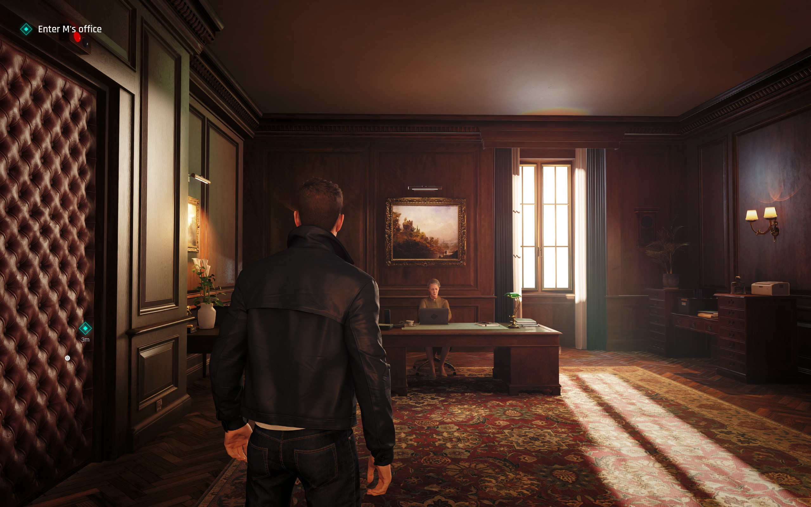
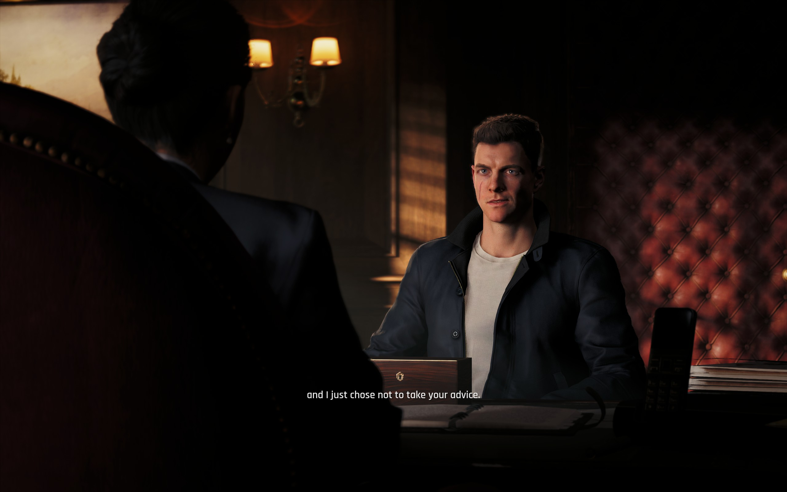
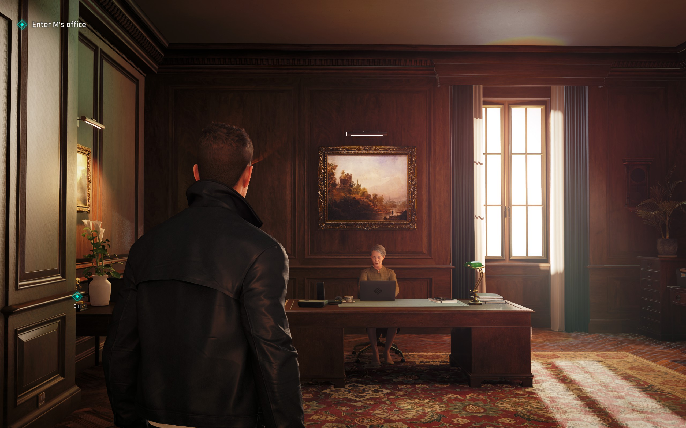
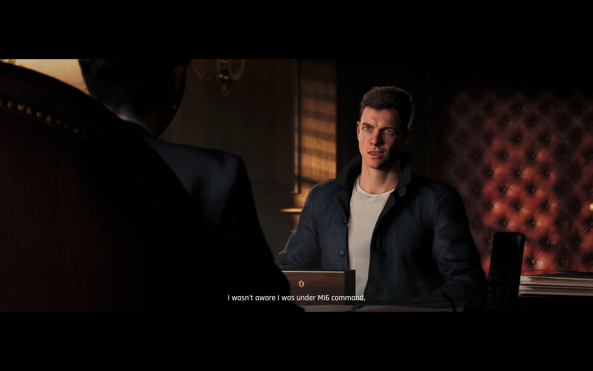

# 007 First Light FOV fix

Dear IOI:

1. Why the fuck is there no FOV slider in the game?!
2. Why are there not only horizontal, but also _vertical_ black bars during
   cutscenes?!?

This is an attempt to fix this hideous mess. I tried to use reflection and
working backwards from render pass metadata as much as possible so hopefully
this should keep working when the game is updated.

# Compilation

Use `build.cmd`.

# Installation

Copy `dinput8.dll` and `FirstLightFOV.ini` next to `007FirstLight.exe`.

# Screenshots

## Fixed

## Default

